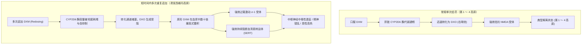
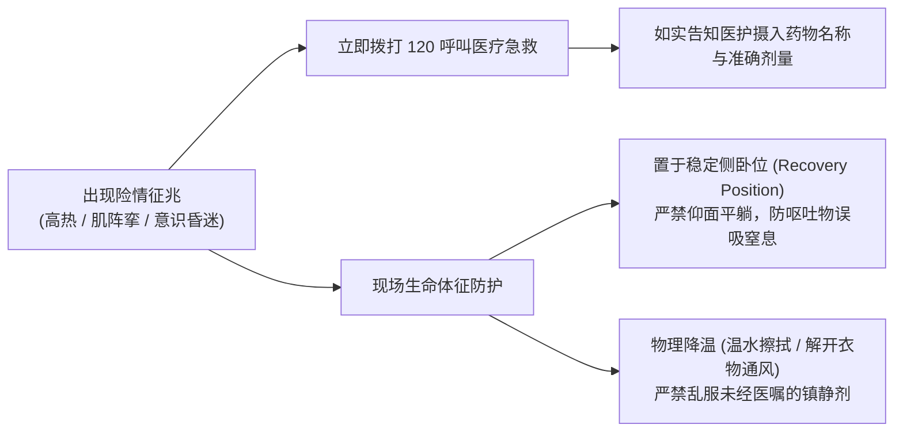

# 🌌 西格玛高原（Plateau Sigma）机制考证与减害指南

> [!danger] 核心毒理警示：绝非精神觉悟，而是重度中枢谵妄与致死性过量
> “西格玛高原（Plateau Sigma）”在神经药理学与临床毒理学上**绝非任何高级意识境界或良性体验**，而是短时间内重复追加给药（Redosing）导致肝脏 CYP2D6 代谢酶彻底饱和耗竭、原药 DXM 在体内非线性病理蓄积所诱发的**急性中毒性谵妄（Toxic Delirium）与药物性精神障碍（Substance-Induced Psychosis）**。
>
> 其伴随着极度痛苦的心境恶劣、恐怖具象幻觉、恶性高热与致命性血清素综合征风险，致死率极高。任何将其神秘化、神圣化的叙事均脱离了药理学与毒理学基本事实。

> [!info] 原始文章信息与本篇重构说明
> * **溯源文章**：极乐实验室《西格玛高原》[\[1\]](#ref-1)
> * **原文地址**：[https://jile.bid/post-22.html](https://jile.bid/post-22.html)
> * **重构考证背景**：原文章在网络用药社区中流传较广，但经专业毒理学与药代动力学审视，原文在**词源溯源**（误将受体名称混淆为数学求和号）、**指导剂量**（推荐的“2-2-4”方案总剂量高达致死量）、**药物联用**（错误建议合用氟伏沙明直接引发致死性血清素综合征）、**成分毒性归因**（混淆愈创甘油醚与 DXM 的毒理表现）以及**主观状态定性**（将中毒性精神错乱浪漫化为“全知统一性”）上存在多处重大事实错误与极端致命的安全隐患。
> * **本篇目的**：本篇旨在以客观、严谨、实证的现代神经药理学为准绳，对原文进行逐项科学重构与漏洞纠偏，还原西格玛高原的真实生理面貌，提供明确的减害救命规程。

---

## 1. 概念溯源与词源辨析

| 考证维度 | 网络流传误区（原文观点） | 现代药理学与历史文献事实 |
| :--- | :--- | :--- |
| **命名来源** | 误认为是数学求和号 $\sum$（Sigma），意指“全部高原综合”。 | **源于人脑中的 $\sigma_1$ 受体（Sigma-1 受体）**[\[2\]](#ref-2)。原形 DXM 强效激动该受体。 |
| **医学本质** | 描绘为“终结了药效、代表一切、具有无所不知统一性的境界”。 | **外源性药物中毒性谵妄（Toxic Delirium）与急性精神病状态**[\[2\]](#ref-2)。 |
| **主观体验** | 带有灵性解脱与超脱感色彩。 | **高度烦躁不安（Dysphoria）、严重偏执狂、惊恐视听幻觉与时间空间崩解**。 |
| **病理持续时间** | 误认为睡一觉即可。 | **急性期持续长达 24 ～ 96 小时（1 ～ 4 天）**，常伴随数周认知损害。 |

### 词源勘误：$\sigma_1$ 受体 vs 数学求和号

* **历史文献出处**：该概念由研究者 William E. White 于 1995 年在其里程碑式文献《The Dextromethorphan FAQ》（第 5.10 与 5.11 节）中系统提出[\[2\]](#ref-2)。
* **命名真相**：White 明确指出，Plateau Sigma 之所以得名，**根本不是源于数学上的累加符号 $\sum$，而是直接指代神经系统中的 $\sigma$ 受体（特别是 $\sigma_1$ 受体，Sigma-1 Receptor）**。
* **为什么叫 Sigma**：单次口服右美沙芬时，肝脏 CYP2D6 会迅速将其代谢转化为右啡烷（DXO）。DXO 具有强效的 NMDA 受体阻滞能力，主导了第 1 至第 4 高原的解离与麻醉体验；而原形右美沙芬（DXM）本身具有高亲和力的 $\sigma_1$ 受体激动活性与血清素再摄取抑制（SRI）活性。当多次追加给药导致代谢酶瘫痪后，体内堆积的原形 DXM 压倒性地占领并激活 $\sigma_1$ 受体，诱发完全不同于常规解离的毒性神经病理学表型，因此 White 定名为“Plateau Sigma”。

---

## 2. 药理学本质：CYP2D6 酶耗竭与原药蓄积

右美沙芬在体内的药效并非单一分子决定，而是由**原形药物（DXM）**与**活性脱甲基代谢物（DXO）**的比例所动态决定的。

### 两种分子的受体亲和力对照

依据生化受体结合实验测定常数（$K_i$ 值越小，结合亲和力越强）：

| 受体靶点 | 原形右美沙芬（DXM）亲和力 | 代谢物右啡烷（DXO）亲和力 | 临床生理反应分工 |
| :--- | :--- | :--- | :--- |
| **NMDA 受体**（解离/麻醉） | 极弱（$K_i \approx 7,000 \sim 10,000\text{ nM}$） | **极强（$K_i \approx 30 \sim 50\text{ nM}$）** | DXO 阻断 NMDA 通道，产生典型的悬浮、感知断联与解离感。 |
| **$\sigma_1$ 受体**（精神病性/谵妄） | **强（$K_i \approx 138 \sim 200\text{ nM}$）** | 较弱（$K_i \approx 1,000 \sim 3,000\text{ nM}$） | DXM 强效激活 $\sigma_1$，介导幻觉、思维破裂、恐慌与狂躁反应。 |
| **SERT**（血清素再摄取抑制） | **高（$K_i \approx 23 \sim 40\text{ nM}$）** | 极弱（$K_i > 500\text{ nM}$） | DXM 阻断血清素回收，过度蓄积时诱发血清素综合征与震颤。 |

### 代谢饱和截流机制

1. **CYP2D6 的自抑制性**：DXM 原药及其初级代谢物本身就是 CYP2D6 的竞争性底物，且对酶蛋白具有明确的自身失活效应。
2. **酶饱和现象**：当数小时内连续多次服药时，初次剂量的代谢过程占用了体内几乎全部具备催化活性的 CYP2D6 酶分子。
3. **消除半衰期剧变**：正常单次服用时 DXM 消除半衰期仅为 **2 ～ 4 小时**；而进入 CYP2D6 酶饱和后，DXM 消除半衰期被病理性延长至 **20 ～ 40 小时甚至数天**。原药在体内迟迟无法被分解排出，对中枢神经产生持久、不可逆转的毒性浸润。

---

## 3. 原文配伍与用药方案的致命漏洞审查

原文在指导服药方式与协同用药方面包含极其危险的误导，必须逐一进行毒理学纠偏：

### 致命漏洞 1：推荐联用氟伏沙明（Fluvoxamine）与西柚汁

> [!danger] 绝对禁止：诱发致死性恶性血清素综合征（Serotonin Syndrome）
> * **原文错误主张**：“如果你想，可以使用一点氟伏沙明，仅限氟伏沙明。在服药前一小时去服用 1t 氟伏沙明”、“喝下至少 100mL 西柚汁”。
> * **毒理学与临床事实**：
>   1. **氟伏沙明（Fluvoxamine）是高选择性 5-羟色胺再摄取抑制剂（SSRI）**，同时也是 CYP1A2 和 CYP2C19 的强抑制剂以及中度 CYP2D6/CYP3A4 抑制剂。
>   2. **右美沙芬（DXM）本身具有强大的 5-羟色胺再摄取抑制作用（$K_i \approx 23\text{ nM}$）**。
>   3. 当两者同时进入人体，且伴随西柚汁（强效肠壁 CYP3A4 抑制剂）阻断第三代谢通道时，中枢与外周血清素（5-HT）的清除与转运被**全面双重封死**，突触间隙血清素浓度在数十分钟内呈现海啸式暴涨！
>   4. 这将直接触发临床极度凶险的 **恶性血清素综合征（Malignant Serotonin Syndrome）**[\[3\]](#ref-3)，表现为**肌阵挛、下肢阵挛、角弓反张、体温迅速突破 41°C（恶性高热）、广泛性癫痫大发作、横纹肌溶解引发急性肾衰竭以及弥漫性血管内凝血（DIC）死亡**。
>   5. 原文评论区网友甚至直接留言警示：“有没有考虑下致命性血清素综合征”。临床医学上，**右美沙芬严禁与任何 SSRI、SNRI、MAOI 或血清素能物质合用，这是铁律禁忌！**

### 致命漏洞 2：“2-2-4 分次服药法” cumulative dose 属于急性致死过量（Lethal Overdose）

> [!danger] 绝对禁止：推荐剂量已深陷临床致死区间
> * **原文推荐方案**：
>   * 第 0 小时：2 高原剂量（12 ～ 24 片 = 180 ～ 360 mg）；
>   * 第 2 小时：2 高原剂量（12 ～ 24 片 = 180 ～ 360 mg）；
>   * 第 4 小时：4 高原剂量（48 ～ 84 片 = 720 ～ 1260 mg）。
> * **实际摄入总药量测算**：
>   * 最低下限：$180 + 180 + 720 = 1080\text{ mg}$（72 片）；
>   * 最早上限：$360 + 360 + 1260 = 1980\text{ mg}$（132 片）。
>   * 以 60 kg 成年人计算，折合给药剂量高达 **18 ～ 33 mg/kg**！
> * **毒理学与临床事实**：
>   1. 在医学毒理学中，右美沙芬口服剂量达到 **$\ge 15\text{ mg/kg}$** 即属于极其严重的急性药物过量，极易导致昏迷与中枢抑制；
>   2. 达到 **$\ge 20\text{ mg/kg}$ 时，属于明确的临床致死剂量（Lethal Dose）**。
>   3. 更致命的是，该方案是在人体 **CYP2D6 酶已经被前两次剂量彻底破坏耗竭** 的前提下，于第 4 小时再次灌入多达 48～84 片（720～1260 mg）！
>   4. 此时肝脏消除机能瘫痪，原药根本无法排出，血药浓度直接越过致死阈值，直接引发中枢性呼吸骤停、恶性心律失常（QTC 延长、尖端扭转型室速 TdP）与心跳骤停。
>   5. 原文所谓“目前到了西格玛高原的都噶了、死亡几率近乎100%”，**并非因为存在某种不可知的高维奥秘，而是因为原文给出的根本就是一份自杀性急性过量配方！**

### 致命漏洞 3：混淆愈创甘油醚（Guaifenesin）与 DXM 的毒性机理

* **原文错误归因**：“不建议使用愈美片来上Σ高原，因为其中的愈创甘油醚过量可能会导致极其严重的呼吸抑制和呕吐现象”。
* **毒理学修正**：
  * **中枢性呼吸抑制绝非愈创甘油醚引起**，而是由高浓度右美沙芬（DXM）及其过量毒性导致脑干呼吸中枢麻痹所致。
  * **愈创甘油醚的真实毒性危险在于**：
    1. **剧烈胃肠刺激与喷射性反胃**：在受试者处于解离、木僵或深度意识障碍时，极易发生**呕吐物反流误吸阻塞气道（Aspiration），引发急性机械性窒息猝死**；
    2. **透光性肾结石与尿路梗阻**：大量摄入愈创甘油醚后，其主要代谢产物 $\beta$-(2-甲氧基苯氧基)-乳酸在尿液中严重过饱和并结晶沉淀，形成 X 射线不显影的透光性结石，引发急性无尿、肾衰竭与严重肾绞痛[\[4\]](#ref-4)。成人每日最大安全上限仅为 2.4 g。

---

## 4. 现象学解构与主观体验：深渊边缘的“浪漫”与幻灭

在亚文化与药物体验的叙事长河中，“西格玛高原”常常被蒙上一层近乎神秘主义的冷冽浪漫光晕——它被描绘为意识的“事件视界（Event Horizon）”，一个超越了时间、肉体与常规药效边界的抽象终局。

### 迷思与象征：被浪漫化的至高荒原

> *“第四高原与第五高原的交界，像是一道切开自我的裂隙。在那意义消亡的高度，语言成为多余的残渣，世界退行成一座无声旋转的几何静物。”*

在用药者的哲学化叙事中，西格玛高原之所以被赋予“全知与统一”的幻象，源于其异于寻常解离的独特性质：
- **时间维度的空间化（Spatialization of Time）**：常规解离（DXO 介导）会让人感到时间的迟缓或断续；而西格玛状态下，时间的线性箭头仿佛彻底折断。过去、现在与未来被压缩在同一张静止的全景画卷中。几秒钟的呼吸被拉长成数个世纪的凝视，让人产生一种置身于“时间尽头、目睹宇宙齿轮停转”的错觉。
- **清醒梦境与现实的重叠（Lucid Delirium）**：与第四高原陷入深沉的麻醉木僵不同，西格玛状态下的眼睛常常是睁开的。但眼前的现实已被神经信号彻底重绘——墙壁可能化作流动的符咒，空气中漂浮着冰冷的几何机械，甚至能与空气中投射出的具象实体展开对话。现实与虚妄的缝隙被彻底抚平，让人误以为自己“看穿了世界后台的源代码”。
- **“我”与“客体”的绝对融合**：在强烈的 $\sigma_1$ 受体激活与血清素狂潮中，大脑负责区分“自体”与“外界环境”的顶叶回路失效。房间的角落即是肢体的延伸，每一处阴影的呼吸都与心跳共振。这种边界的消融，在文学修辞中常被附会为“梵我合一”或“意识的无所不知”。

---

### 解构与真相：神经内爆的残酷现实

然而，揭开诗性隐喻的帷幕，现代神经药理学与临床毒理学为我们揭示的，是一场中枢神经系统在剧毒侵蚀下的悲剧性内爆：

> [!warning] 所谓“全知”，不过是质疑机制的死亡
> 人脑之所以能思考，依赖于前额叶对海量感知杂讯的严密过滤与真伪校对。在 CYP2D6 耗竭导致原药 DXM 暴风雨般的侵袭下，负责理性反思的抑制性神经元最先疲惫瘫痪。  
> 大脑失去了“怀疑自身”的能力——任何无规律的神经元自发放电，都会被毫无保留地当成“不可撼动的宇宙真理”。那种所谓的“顿悟”，本质是认知校对系统的全线溃散。

| 体验维度 | 迷思与浪漫修辞 | 临床毒理学真实机制 |
| :--- | :--- | :--- |
| **心境性质** | 虚无主义的冷冽超脱、看破世俗 | **重度心境恶劣（Dysphoria）与惊恐**。受体超载引发持续性急性焦虑、濒死感与无休止的被害妄想。 |
| **知觉体验** | 穿梭于多维宇宙、具象实体对话 | **恶性外源性精神病幻觉**。多为威胁性、恐怖性的视听错乱（如窥视感、躯体变形妄想、恶性耳语）。 |
| **思维状态** | 超越逻辑的宇宙全知、直觉洞察 | **严重思维破裂与强迫性思维死循环（Thought Loops）**。意识被困在一个微小念头中往复研磨数小时，无法自拔。 |
| **时空感知** | 时间停止、永恒静止的凝固感 | **时间感知神经回路锁死**。患者在主观上经历漫长如“无间地狱”的时间停滞，带来毁灭性的精神折磨。 |
| **躯体代价** | 摆脱肉身桎梏、意识轻灵漫游 | **严重的自主神经危象**。恶性高热（体温失控）、广泛性肌阵挛、下肢阵挛、高血压危象与横纹肌溶解风险。 |
| **退行后遗症** | 精神洗礼后的超然脱俗 | **漫长且不可逆的认知创伤**。数周至数月的重度去人格化/去现实化障碍（DP/DR）、情感麻木与执行功能退化。 |

西格玛高原是意识在坠入深渊前，神经突触在过载短路中所迸发的最冷冽的极光。它并不通往真理，正如溺水者在肺叶灌满冰水前所见的最后一片绚烂光斑——那种美丽带着绝对的致命性。

---

## 5. 科学减害指南与急救应对规程

针对右美沙芬的高原反应机制，所有安全减害的核心均在于**绝对预防与避免进入西格玛状态**：

### 核心减害戒律

1. **绝对严禁短时间内重复追加给药（Never Redose）**：
   * 任何试图在同一天内、数小时内分次追服 DXM 的行为，均会直接导致 CYP2D6 耗竭与原药蓄积风险，这是引发西格玛谵妄的唯一诱因。
   * 用药后必须等待数天甚至数周让身体代谢酶系统与受体充分恢复。
2. **绝对严禁联用血清素能物质**：
   * 严禁合用任何 SSRI（如氟伏沙明、氟西汀、舍曲林）、SNRI（如文拉法辛、度洛西汀）、MAOI、三环类抗抑郁药、曲马多或右苯丙胺类物质。
3. **严禁使用代谢抑制剂刻意增效**：
   * 禁止在大量服药时联用西柚汁、安非他酮等强 CYP 抑制剂，人为关闭代谢通道等同于慢性自杀。
4. **警惕复方杂质**：
   * 严禁通过过量服用含有愈创甘油醚、扑尔敏（氯苯那敏）、对乙酰氨基酚的复方制剂（如愈美片、氨酚美芬）追求高剂量。

### 危急征兆识别（Hunter 血清素中毒标准）

若出现以下任一组合，表明受试者已出现中枢中毒性危象，必须立刻急救：
* **自发性肌阵挛**（肌肉不自主规律抽动）；
* **诱发性肌阵挛伴随激越、大汗**；
* **眼球阵挛伴随定向力丧失**；
* **体温骤升超过 38.5°C 且伴随震颤与反射亢进**；
* **意识陷入深度木僵、呼吸低于 10 次/分**。

### 现场急救操作

1. **立刻呼叫 120 急救电话**：向急救中心明确说明患者服用了“超大剂量右美沙芬”，并说明是否合用了其他药物，以便急救人员携带纳洛酮、苯二氮䓬类药物与气管插管设备。
2. **摆放标准恢复体位（稳定侧卧位）**：
   * 将患者身体侧卧，头部向后微仰以开放气道，上方手臂与腿部弯曲支撑身体。
   * **严禁仰面平躺**，以防突发呕吐导致胃内容物误吸入气管窒息死亡。
3. **环境与物理处置**：
   * 保持空气流通，解开领口衣物；
   * 高热患者采用温水湿敷额头与颈部进行物理降温，切忌自行乱喂其他退烧药或中枢药物。

---

## 参考来源

1. [极乐实验室：西格玛高原（原始网络存档文章）](https://jile.bid/post-22.html) —— 原文链接，供药理对比与历史纠偏考证。
2. [White WE. The Dextromethorphan FAQ: Answers to Frequently Asked Questions about Dextromethorphan. Section 5.10-5.11 (Plateau Sigma). 1995](https://erowid.org/chemicals/dxm/faq/dxm_faq.shtml) —— 奠定 Plateau Sigma 命名历史与 $\sigma$ 受体关联的奠基性文献。
3. [Boyer EW, Shannon M. The Serotonin Syndrome. New England Journal of Medicine, 2005, 352(11): 1112-1120 (PubMed: 15784664)](https://pubmed.ncbi.nlm.nih.gov/15784664/) —— 确立血清素综合征 Hunter 诊断标准，明确指出右美沙芬与 SSRI/MAOI 配伍引发的恶性致死机制。
4. [Bennett et al. Guaifenesin-Induced Radiolucent Urolithiasis. The Journal of Urology, 1999, 162(5): 1664-1665 (PubMed: 10524894)](https://pubmed.ncbi.nlm.nih.gov/10524894/) —— 证实复方制剂中愈创木酚甘油醚代谢产物过饱和析出导致透光性肾结石与尿路梗阻的临床毒理学文献。
5. [PsychonautWiki: Dextromethorphan & Plateau Sigma](https://psychonautwiki.org/wiki/Dextromethorphan) —— 现代精神活性物质数据库关于 DXM 药代动力学、CYP2D6 酶饱和与 Plateau Sigma 的客观记录。
6. [FreeODwiki：右美沙芬](https://freeodwiki.org/%E8%8D%AF%E7%89%A9/%E5%8F%B3%E7%BE%8E%E6%B2%99%E8%8A%AC.html) —— 开源减害百科关于右美沙芬受体机制与不良反应的综合参考。

