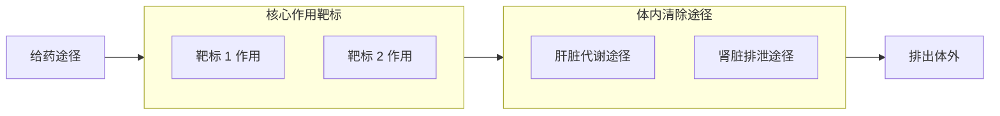

# 📋 药物条目编写规范与标准模板

为了确保 Angelic Wiki 药物条目保持**高度客观、清晰易读、科学严谨**，后续无论是人类贡献者还是 AI Agent 协助编写新药物页面，请一律严格遵循本指南及文末的标准模板。

---

## 🧭 三大编写核心原则

1. **绝对严禁凭空捏造事实（严禁臆造数据与机制）**
   * 药物科学关乎生命安全，**任何捏造药理机制、虚构剂量、伪造受体亲和力或篡改毒性数据的行为都是致命的**。
   * 所有数据（受体常数 $K_i$、半衰期 $t_{1/2}$、血浆达峰时间 $T_{\max}$、代谢排泄率、相互作用禁忌）必须严格源自权威药理数据库（DrugBank、PubChem、FDA 药品单行本）或经同行评审的 PubMed 科学文献。
   * 所有非医疗场景的剂量梯次、时间轴与主观表现，必须严格采纳权威开源减害社区（FreeODwiki、Erowid、PsychonautWiki）的统计报告，并在文末逐一锚定原始链接。

2. **客观中立，将减害逻辑内化于药理机制中**
   * 严禁小说式煽情或恐吓性文学修辞。
   * 减害（Harm Reduction）不是说教，而是**通过清晰呈现药代动力学（PK）与药效动力学（PD）规律，让读者明确理解为什么某种操作（如频次补药、不当混用、改变代谢环境）会引发致命毒性**。

3. **高度模块化，保持视觉与排版统一**
   * 严格对照参考基准条目（如 [[愈美片]]、[[美金刚]]）的板块层级结构。
   * 善用加粗要点列表、对照表格、Mermaid 链路图与 Callout 警示框。

---

## 🧩 标准条目模块拆解

每个完整的药物文档由以下 6 个核心部分构成：

### 1. Frontmatter（元数据）
* `title`：药物中文名 / 药物外文名或盐类名
* `description`：一句话客观概括核心机制、适应证与主要风险
* `tags`：标签分类（如 `药品科普`、`处方药`、`解离剂`、`减害指南`、`用药安全` 等）
* `aliases`：别名、商品名、常用缩写

### 2. 顶部警示框（Top Callouts）
* `> [!danger]` **核心警示金句**：深刻、警醒且客观地概括该药物最具隐蔽性或毁灭性的药理/心理陷阱。
* `> [!danger] 危险的药物相互作用`：直接列出具有配伍禁忌的全部物质类别。

### 3. `## 1. 核心受体机制`
保持极简单行格式，格式统一为：
```markdown
* **作用类型**：受体名称（简要机制说明）<sup>[引文]</sup>
```

### 4. `## 2. 药效时间与参考剂量`
* **作用时间轴表格**：包含总持续时间、起效、上升、达峰、平台维持、褪去、残余。
* **参考剂量表格**：明确注明为针对无耐药性标准体重，分为医学剂量、轻微、中等、强烈、严重/过量。
* **动力学特殊风险警示框**：如代谢酶缺陷（CYP2D6 多态性）、超长半衰期蓄积陷阱或追加给药（Redosing）致死风险。

### 5. `## 3. 剂量反应与分级表现`
* 以表格形式详述不同剂量阶段的主观状态、外在体征与心理表现。
* 下附致死过量（Lethal Overdose）警示及特征性毒性预警（如结石、蓄积谵妄、血清素综合征）。

### 6. `## 4. 近代史`
* 研发背景与合成年份。
* 临床获批上市历程与适应证定位。
* 亚文化滥用演变与法律监管属性（OTC/Rx/麻精管制）。

### 7. `## 5. 药理机制与体内代谢全景`
* **Mermaid 流程图**：展示吸收 $\to$ 受体靶标分工 $\to$ 代谢酶/肾清除途径。
* **减害调控子章节**：深入剖析酶抑制/诱导、尿液 pH 值等对体内有效血药浓度的剧烈影响，提供科学减害知识。

### 8. `## 参考来源`
* 规范的带编号锚点列表，链接到真实权威文献与社区减害维基。

---

## 📄 可直接复用的 Markdown 标准模板

后续撰写新药物条目时，可直接复制下方结构源码进行填空编写：

````markdown
---
title: 药物中文名/主要外文名
description: 客观简炼的一句话药理概括（类别、靶标、用途与核心风险）
tags:
  - 药品科普
  - 处方药
  - 类别标签
  - 减害指南
  - 用药安全
aliases:
  - 常见别名
  - 商品名
---

> [!danger] 核心安全警示金句
> 此处客观陈述该药物最核心的危险特性（如半衰期极长易蓄积、严重呼吸抑制或血清素综合征风险）<sup>[\[1\]](#ref-1)</sup>。

> [!danger] 危险的药物相互作用
> 相互作用药物类别 1、类别 2、中枢抑制剂、兴奋剂、酒精等<sup>[\[1\]](#ref-1)[\[2\]](#ref-2)</sup>

---

## 1. 核心受体机制

* **作用类别**：受体 1（简要机制说明）<sup>[\[1\]](#ref-1)</sup>
* **作用类别**：受体 2（简要机制说明）<sup>[\[2\]](#ref-2)</sup>
* **作用类别**：受体 3（简要机制说明）<sup>[\[3\]](#ref-3)</sup>

---

## 2. 药效时间与参考剂量

### 作用时间轴

| 阶段 | 药效时长 |
| :--- | :--- |
| **总持续时间** | **X ～ X 小时** |
| **药效发作** | X ～ X 分钟 |
| **药效上升** | X ～ X 分钟 |
| **药效达峰** | X ～ X 小时 |
| **药效平台** | X ～ X 小时 |
| **药效褪去** | X ～ X 小时 |
| **药效残余** | **X ～ X 小时** |

### 参考剂量

针对无耐药性标准体重的参考剂量阶梯（注明剂型与给药途径）：

| 级别 | 单次总剂量区间 | 对应状态预估 |
| :--- | :--- | :--- |
| **医学剂量** | X mg | 临床常规剂量表现 |
| **轻微** | X ～ X mg | 轻度反应，感官微变 |
| **中等** | X ～ X mg | 明显精神药理反应与知觉改变 |
| **强烈** | X ～ X mg | 深度主观效应，认知与运动受阻 |
| **严重** | X mg + | 极度生理毒性与严重不良反应 |

> [!danger] 核心药代动力学警示（代谢酶/半衰期蓄积/补药陷阱）
> 详细阐述代谢缺陷、超长半衰期或多次补药导致的指数级蓄积中毒机制<sup>[\[1\]](#ref-1)</sup>。

---

## 3. 剂量反应与分级表现（无耐药性标准）

| 预计层级 | 最低剂量 | 最高剂量 | 核心表现 |
| :--- | :--- | :--- | :--- |
| **医学剂量** | — | X mg | 仅发挥临床治疗效应，无特殊主观改变。 |
| **第一阶梯（轻微）** | X mg | X mg | 初步主观反应描述。 |
| **第二阶梯（中等）** | X mg | X mg | 显著精神药理学变化，动作与思维表现。 |
| **第三阶梯（强烈）** | X mg | X mg | 深度知觉改变或阻断，自理能力受损。 |
| **第四阶梯（严重）** | X mg | X mg | 极高风险重度状态。 |
| **致死过量 / 蓄积中毒** | 频次蓄积 / $\ge$ X mg | — | <span class="rainbow-text" data-text="† 谵妄与中毒危象 †">† 谵妄与中毒危象 †</span> |

> [!danger] 致死过量危象警示
> 描述急性过量或严重蓄积时的临床危象与潜在致死机理<sup>[\[1\]](#ref-1)</sup>。

> [!warning] 特征性生理损伤警示
> 提示该药物特殊的器官毒性（如膀胱结石、横纹肌溶解或高热综合征）及每日安全上限<sup>[\[2\]](#ref-2)</sup>。

---

## 4. 近代史

* **研发背景**：合成年份、研发机构及初始意图。
* **临床批准**：获批年份、适用疾病与医学定位。
* **亚文化流变**：非医疗场景滥用演进与急诊案例背景。
* **法律监管现状**：在相关国家和地区的处方级别或麻精管制分类。

---

## 5. 药理机制与体内代谢全景



### 关键代谢与排泄机制

#### 代谢抑制 / 排泄阻断（高危风险）
* **原理**：某种物质抑制关键代谢通道导致原药在体内过度蓄积的机制。
* **高危配伍**：具体物质与药物禁忌。

#### 代谢调控与减害防护
* **原理**：促进正常清除或避免毒性加重的客观生理机制。

> [!danger] 核心配伍绝对禁忌

---

## 参考来源

1. <span id="ref-1"></span>[文献/条目名称 - 来源平台 1](https://example.com)
2. <span id="ref-2"></span>[文献/条目名称 - 来源平台 2](https://example.com)
````
