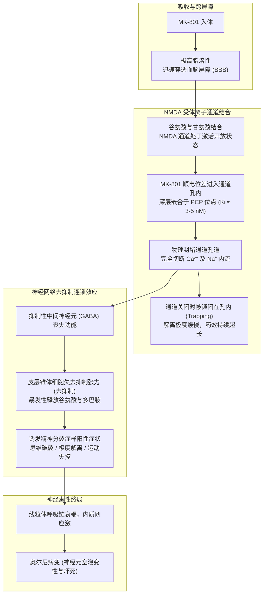

> [!danger] 核心安全警示：实验室科研专用毒性工具药，绝非娱乐性物质
> 地佐环平（MK-801）是目前已知**效力最强、选择性最高**的非竞争性 NMDA 受体通道阻滞剂之一。**其绝非安全或可控的精神活性物质，而是神经科学实验室专用于构建精神分裂症动物模型与神经毒性研究的工具药**。
>
> 其亲和力达纳摩尔级（nM），具有深度通道捕获（Trapping Block）与极慢解离特性。微克（$\mu\text{g}$）级剂量即可引发长时间的严重精神错乱、现实感知全面瓦解与运动共济失调，并在哺乳动物脑内诱发不可逆的神经元空泡样变性坏死（**奥尔尼病变，Olney's Lesions**）[\[2\]](#ref-2)。人体任何非科研接触均伴随灾难性的永久认知致残风险。

> [!danger] 绝对禁止多药混用
> 严禁与中枢神经系统抑制剂（如酒精、苯二氮䓬类、阿片类、巴比妥类）混用，协同呼吸抑制与运动中枢麻痹可迅速致死；严禁与兴奋剂、血清素能物质合用，极易触发恶性精神运动性激越与体温调节崩溃。

---

## 1. 核心受体机制

地佐环平（MK-801）通过高亲和力嵌合中枢神经系统离子通道发挥极端阻滞效应：

- **非竞争性阻断 NMDA 受体**：以极高亲和力（$K_i \approx 3 \sim 5\text{ nM}$）结合于 NMDA 受体通道孔道深处的苯环己哌啶（PCP）结合位点。属于严格的**使用依赖性（Use-dependent）开管孔道阻滞剂**，仅在通道处于开放状态时进入并物理封堵离子流，阻断 $\text{Ca}^{2+}$ 等阳离子内流；其解离速率极度缓慢，具有显著的**通道捕获（Trapping block）**效应[\[1\]](#ref-1)[\[3\]](#ref-3)。
- **皮质去抑制与多巴胺激增**：优先阻断皮层 GABA 能抑制性中间神经元上的 NMDA 受体，切断其对锥体细胞的抑制张力，导致谷氨酸能爆发式异常放电，并间接引起前额叶与纹状体多巴胺（DA）急剧释放，模拟**精神分裂症阳性症状**[\[4\]](#ref-4)。
- **微弱结合次级靶点**：在微摩尔级浓度下对神经元烟碱型乙酰胆碱受体（nAChR）具有阻断活性，并对多巴胺转运体（DAT）产生微弱抑制，协同加剧震颤、意识模糊与共济失调。

---

## 2. 药效时间与参考剂量

> [!warning] 剂量单位为微克（$\mu\text{g}$），非毫克（$\text{mg}$）
> 地佐环平活性效力比常规解离剂（如氯胺酮）高出数百倍，常规物理天平根本无法精确量取微克级粉末，极易因粉尘误吸或称量误差导致数十倍急性致死过量！

### 作用时间轴

| 阶段 | 药效时长 |
| :--- | :--- |
| **总持续时间** | **8 ～ 24 小时** |
| **药效发作** | 30 ～ 90 分钟 |
| **药效上升** | 60 ～ 120 分钟 |
| **药效达峰** | 2 ～ 4 小时 |
| **平台维持** | 4 ～ 8 小时 |
| **药效褪去** | 4 ～ 12 小时 |
| **药效残余（宿醉/认知迟钝）** | **8 ～ 72 小时（甚至数天）** |

### 参考剂量（以无耐药性标准体重的口服剂量推算，仅作毒理与减害科普）

| 级别 | 单次摄入剂量 | 神经系统表现与风险预估 |
| :--- | :--- | :--- |
| **阈值** | 200 $\mu\text{g}$（0.2 mg） | 感知轻微迟钝，思维速度减慢，眼球轻微震颤 |
| **轻度** | 200 ～ 300 $\mu\text{g}$ | 轻度解离感，步态不稳，情绪平淡，轻微空间扭曲 |
| **中度** | 300 ～ 700 $\mu\text{g}$ | 显著解离，共济失调严重，言语模糊，时间感知彻底碎裂 |
| **强效** | 700 ～ 1500 $\mu\text{g}$ | 深度解离障碍，出现类精神分裂症状态（幻听、妄想、思维混乱） |
| **严重/致死过量** | **1500 $\mu\text{g}$ +（1.5 mg +）** | **完全木僵、深昏迷、恶性高热、呼吸暂停、永久性脑损伤** |

---

## 3. 剂量反应与分级表现

| 阶段 / 状态 | 主观认知体验 | 外在体征与生理表现 | 毒理病理风险 |
| :--- | :--- | :--- | :--- |
| **轻微阶段** (< 300 $\mu\text{g}$) | 空间感微弱漂浮，思考费力，情感冷漠与现实脱离。 | 轻微眼球震颤，瞳孔轻度散大，腱反射亢进，轻微口齿不清。 | 暂时性工作记忆损害与反应力下降。 |
| **中等阶段** (300 ～ 700 $\mu\text{g}$) | 强烈的躯体脱节感，感觉身体并非由自己控制；时间箭头断裂，无法进行连贯逻辑思考。 | 明显的**共济失调**（行走如机械人或完全无法站立），言语断续，恶心呕吐。 | 跌倒撞击外伤、误吸呕吐物导致窒息风险。 |
| **强效阶段** (700 ～ 1500 $\mu\text{g}$) | 深度解离与现实完全隔离；视听幻觉泛滥、强烈的迫害妄想与恐怖思维循环；自我消亡（Ego Death）。 | 全身肌张力异常增高，刻板重复动作（Head-weaving），呼吸节律浅慢，心动过速。 | 急性精神病发作、剧烈精神创伤后应激、自主神经功能危象。 |
| **致死过量阶段** (> 1500 $\mu\text{g}$) | 意识丧失、深昏迷，神经元信号传导全线崩溃。 | **紧张性木僵（Catatonia）**、癫痫持续状态、恶性高热、中枢性呼吸衰竭、心跳骤停。 | **广泛性皮质神经元空泡变性与坏死（奥尔尼病变）**，不可逆脑死亡。 |

> [!danger] 神经毒性：奥尔尼病变（Olney's Lesions）
> 1989 年，神经病理学家 John W. Olney 首次在《Science》发表里程碑研究证实：大鼠注射地佐环平（MK-801）后，其大脑**脾后皮质（Retrosplenial Cortex）与后扣带回皮质**的锥体神经元内迅速出现大量液泡，线粒体严重肿胀破裂（被称为**NMDA 受体拮抗剂神经毒性，NAN**）[\[2\]](#ref-2)。
> 
> 虽然低剂量诱发的液泡在短时间内表现出一定可逆性，但随着剂量提升或时间延长，空泡样变性迅速演变为不可逆的**神经元坏死与永久性皮层退行性缺失**。这一不可避免的结构性神经毒性，直接终结了地佐环平作为人类临床药物的任何研发前景。

---

## 4. 近代史

- **1982 年（合成研发）**：默克公司（Merck & Co.）实验室研究团队首次合成地佐环平，代号定为 **MK-801**。初衷是开发一种高效的抗癫痫、抗惊厥药物，并作为中风及创伤性缺血性脑损伤后的“神经保护剂”[\[1\]](#ref-1)。
- **1986 年（机制破译）**：Wong 等人在《美国国家科学院院刊》（PNAS）上发表经典文献，正式证实 MK-801 是一种极强效、高选择性的非竞争性 NMDA 受体阻滞剂，其对 PCP 受体位点的阻断效力数倍于苯环己哌啶和氯胺酮[\[1\]](#ref-1)。
- **1989 年（临床流产）**：Olney 博士揭示了 MK-801 在动物大脑皮质中引发的空泡化神经毒性（奥尔尼病变）[\[2\]](#ref-2)。加之临床前试验中受试动物表现出的极端运动崩溃与拟精神病状态，默克公司彻底终止了地佐环平的一切人类临床应用研究。
- **1990 年代至今（科研基准）**：尽管人体研发止步，MK-801 凭借其极高的特异性与稳定性，成为全世界神经药理学领域的**金标准工具药**：
  1. **精神分裂症动物模型**：用于筛选与评价新型非典型抗精神病药物的药效机制；
  2. **突触可塑性研究**：用于探究长时程增强（LTP）、学习记忆神经回路及兴奋性神经毒性基础理论；
  3. **狂犬病毒基础实验**：部分体外研究探索其在抑制某些病毒复制中的理论靶点。

---

## 5. 药理机制与体内代谢全景

### 药代动力学特性

1. **高脂溶性与中枢分布**：MK-801 分子中含有稳定的二苯并环庚烯骨架，脂溶性极佳，给药后可在数分钟内迅速富集于大脑皮层、海马与纹状体。
2. **“捕获阻滞”（Trapping Block）动力学**：不同于美金刚（Memantine）快速结合、快速解离（Fast-off）的良性动力学特征，MK-801 属于极端的“慢结合、极慢解离（Slow-off）”。一旦通道关闭，MK-801 会被长期封锁在受体孔内，甚至在清洗组织或受体关闭后依然无法脱落，导致中枢解离效应长达数十小时。
3. **代谢与消除**：主要依赖肝脏微粒体细胞色素 P450 酶系进行芳香环羟基化与葡萄糖醛酸结合代谢，最终经肾脏缓慢排泄。

---

## 参考来源

1. [Wong EH, Kemp JA, Priestley T, et al. The anticonvulsant MK-801 is a potent N-methyl-D-aspartate antagonist. Proc Natl Acad Sci USA, 1986, 83(18): 7104-7108.](https://www.pnas.org/doi/10.1073/pnas.83.18.7104) —— 首次证实 MK-801 是纳摩尔级强效 NMDA 拮抗剂的奠基文献。
2. [Olney JW, Labruyere J, Price MT. Pathological changes induced in cerebrocortical neurons by phencyclidine and related drugs. Science, 1989, 244(4910): 1360-1362.](https://www.science.org/doi/10.1126/science.2660263) —— 首次证实 MK-801 等强效 NMDA 拮抗剂在啮齿类动物大脑诱发奥尔尼病变（神经元空泡化）的经典文献。
3. [Huettner JE, Bean BP. Block of N-methyl-D-aspartate-activated current by the anticonvulsant MK-801: Selective binding to open channels. Proc Natl Acad Sci USA, 1988, 85(4): 1307-1311.](https://www.pnas.org/doi/10.1073/pnas.85.4.1307) —— 揭示 MK-801 具有使用依赖性（Use-dependent）开管阻滞机制的电生理学研究。
4. [Adell A. Brain NMDA Receptors in Schizophrenia and Depression. Biomolecules, 2020, 10(6): 947.](https://pmc.ncbi.nlm.nih.gov/articles/PMC7355745/) —— 阐明 NMDA 受体阻断导致 GABA 中间神经元失活、进而引发皮质去抑制及精神分裂症症状的分子网络机制。
5. [PubChem Compound Summary: Dizocilpine (CID 180081)](https://pubchem.ncbi.nlm.nih.gov/compound/Dizocilpine) —— 美国国家生物技术信息中心（NCBI）关于地佐环平的理化性质与生物活性数据。
6. [MK-801 - FreeODwiki 开源 Overdose 百科](https://freeodwiki.org/%E8%8D%AF%E7%89%A9/MK-801.html) —— 开源减害社区关于 MK-801 的剂量、时长与主观毒理反应记录。

