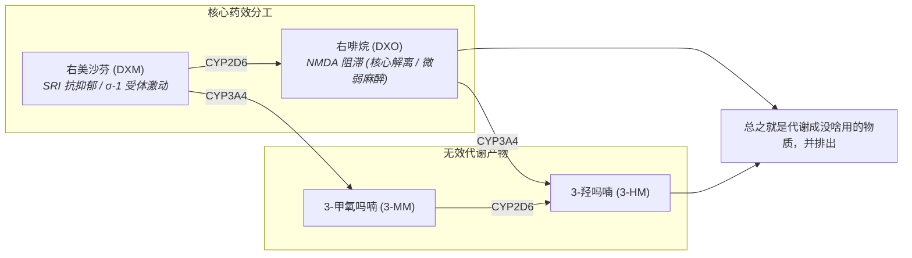

> [!danger] 当你在溺亡时，还坚信自己只是在呼吸。
> 右美沙芬可侵袭、破坏、篡改认知，让人认知不到自己处于滥用与成瘾之中，并误认为滥用与成瘾才是正常。

> [!danger] 危险的药物相互作用
> 苯二氮䓬类物质、大麻、2,5-二甲氧基苯丙胺类物质、25x-NBOMe、4-硫基-2,5-二甲氧基苯乙胺类物质、5-MeO-xxT、苯丙胺类物质、可卡因、安非他酮、αMT、PCP、MDMA、酒精、GHB、GBL、阿片类药物、曲马多、MAOI、SSRI、抗组胺药

## 1. 核心受体机制

* **抑制再摄取**：血清素 / STN
* **拮抗受体**：NMDA（非竞争性）
* **激动受体**：$\sigma$-1 / Sigma-1

---

## 2. 药效时间与参考剂量

### 作用时间轴

| 阶段 | 药效时长 |
| :--- | :--- |
| **总持续时间** | **8 ～ 12 小时** |
| **药效发作** | 30 ～ 120 分钟 |
| **药效上升** | 60 ～ 120 分钟 |
| **药效达峰** | 3 ～ 6 小时 |
| **药效褪去** | 2 ～ 4 小时 |
| **药效残余** | **4 ～ 24 小时** |

### 参考剂量

针对无耐药性标准体重的参考剂量阶梯：

| 级别 | 单次总剂量区间 | 对应高原预估 |
| :--- | :--- | :--- |
| **阈值** | 75 mg | 接近临床止咳上限，轻微情绪微变 |
| **轻度** | 100 ～ 200 mg | 第一高原（1.5 ～ 2.5 mg/kg） |
| **中度** | 200 ～ 400 mg | 第二高原（2.5 ～ 7.5 mg/kg） |
| **强效** | 400 ～ 700 mg | 第三高原（7.5 ～ 15 mg/kg） |
| **极限** | 700 mg + | 第四高原及以上（$\ge$ 15 mg/kg） |

> [!danger] CYP2D6 代谢酶缺陷警示
> 人群中约有 5%～10% 的个体属于 **CYP2D6 慢代谢者**。此类人群代谢 DXM 极其缓慢，体内原药蓄积风险成倍剧增：**普通人的轻度剂量（如 100mg）在慢代谢者体内即可直接产生等同于重度甚至第三/第四高原的强效且漫长的解离毒性反应**！在不确定自身酶活性前，切勿贸然尝试任何非医疗剂量。

---

## 3. 高原分级与剂量反应（无耐药性，按每千克体重计算）

右美沙芬在不同剂量区间会呈现阶梯式、质变的神经反应，社区与文献通常将其划分为以下“高原（Plateaus）”层级：

| 预计层级 | 最低剂量 | 最高剂量 | 核心表现 |
| :--- | :--- | :--- | :--- |
| **医学剂量** | — | 1t～2t，每日三次 | 仅止咳，无特殊反应（“于此，什么都不会发生。右美沙芬只是个很好用的止咳药”）。 |
| **第一高原** | 1.5 mg/kg | 2.5 mg/kg | 出现抗抑郁作用，解离轻微可察觉。 |
| **第二高原** | 2.5 mg/kg | 7.5 mg/kg | 精神作用显著，解离出现，抗抑郁逐步提升，躁狂不明显；难以入睡，去抑制、运动增益出现。 |
| **第三高原** | 7.5 mg/kg | 15 mg/kg | 精神作用非常显著，解离与抗抑郁明显，可观察到躁狂；几乎无法入睡，去抑制与运动增益极大（感觉不到疲劳）；感知与认知被深度解离；属于安全前提下药效最大的高原。 |
| **第四高原** | 15 mg/kg | 20 mg/kg | 药效在第三高原基础上急剧增强；解离达到临床手术麻醉级别，肢体操控能力严重丧失；高血压危象、呼吸暂停、心跳骤停风险剧增；血清素浓度极度过载导致血清素综合征与躁狂混合。 |
| **第五高原** | 20 mg/kg | — | † 升天 † |

> [!warning] 警惕愈创木酚甘油醚中毒
> 上述高原分级剂量仅基于 **右美沙芬（DXM）** 活性成分测算。**愈美片为复方制剂**（每片含 100mg 愈创木酚甘油醚），仅用于刺激胃黏膜反射性祛痰。若为了追求右美沙芬的效果而过量吞服，过量的愈创木酚甘油醚可能引发**强烈的胃部痉挛、剧烈喷射性恶心狂吐**，对消化道造成急性损伤！并且其代谢产物（$\beta$-(2-甲氧基苯氧基)-乳酸）在尿液中严重超饱和，沉淀析出结晶，形成**透光性肾结石/膀胱结石**！大剂量短时间内可引起急性腰部绞痛、血尿甚至完全尿道堵塞（无尿/尿潴留）。**每日最大安全剂量上限为 2.4g**。

---

## 4. 近代史

**愈美片**（及愈美颗粒、愈美糖浆等制剂）是一种临床广泛用于缓解感冒、支气管炎等呼吸道疾病引起的咳嗽与咳痰的复方制剂。

随着右美沙芬滥用问题演变，国家对其监管层级逐步全面收紧：
- **单方右美沙芬**：2021 年底由 OTC 转为处方药并全网禁售；随后于 **2024 年 7 月 1 日** 起被正式列入**第二类精神药品目录**，按毒品与麻精药品标准严惩滥用。
- **愈美复方制剂**：单方被列管后引发了对复方制剂的严重代偿性滥用。为此，国家三部门于 **2026 年 4 月 20 日** 联合发文**全面禁止网络零售愈美制剂**；同年 **9 月**，国家药监局正式将愈美片等 7 个相关制剂品种**全线由非处方药（OTC）转换为处方药（Rx）**，并实行实名登记与线下严格限量销售。

---

## 5. 药理机制与体内代谢全景

### 酶抑制

体内主要由 **CYP2D6** 和 **CYP3A4** 两种肝脏代谢酶参与转化。你可以根据想要的药效倾向了解酶的抑制方式，但**务必严格注意禁忌**：

#### 抑制 CYP3A4：提升综合强度与延长时间
* **原理**：CYP3A4 专门把有用的 DXM 和 DXO 代谢成废料（3-MM 和 3-HM）。抑制 CYP3A4 可以切断这两种无效清除通道，从而**显著增强药效综合顶峰，让有效浓度维持更久**。
* **常见方法**：喝西柚汁。

#### 抑制 CYP2D6：增强抗抑郁，削弱解离
* **原理**：CYP2D6 负责将 DXM 转化为带来解离感的 DXO。如果抑制了 CYP2D6，DXM 无法转化为 DXO，结果就是**解离感减弱，而 DXM 蓄积带来的 SRI（血清素再摄取抑制）抗抑郁效应显著增强**。
* **常见途径**：安非他酮?

> [!danger] 禁止同时抑制 CYP2D6 和 CYP3A4

---

## 参考来源

- [Dextromethorphan - PsychonautWiki](https://m.psychonautwiki.org/wiki/Dextromethorphan)
- [右美沙芬 - FreeODwiki——可自由编辑的开源Overdose百科](https://freeodwiki.org/%E8%8D%AF%E7%89%A9/%E5%8F%B3%E7%BE%8E%E6%B2%99%E8%8A%AC.html)
