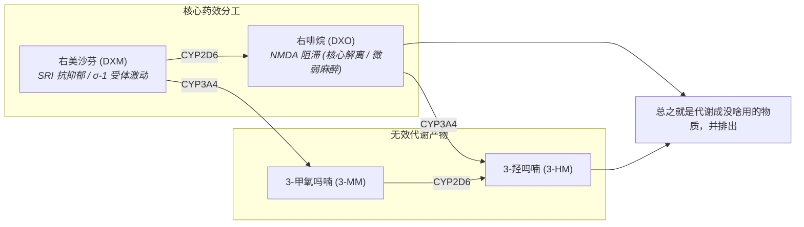

> [!danger] 当你在溺亡时，还坚信自己只是在呼吸。
> 右美沙芬可侵袭、破坏、篡改认知，让人认知不到自己处于滥用与成瘾之中，并误认为滥用与成瘾才是正常。

> [!danger] 危险的药物相互作用
> 苯二氮䓬类物质、大麻、2,5-二甲氧基苯丙胺类物质、25x-NBOMe、4-硫基-2,5-二甲氧基苯乙胺类物质、5-MeO-xxT、苯丙胺类物质、可卡因、安非他酮、αMT、PCP、MDMA、酒精、GHB、GBL、阿片类药物、曲马多、MAOI、SSRI、抗组胺药

---

## 1. 核心受体机制

* **抑制再摄取**：血清素（SERT）及去甲肾上腺素（NET）
* **拮抗受体**：NMDA（非竞争性，主要由活性代谢产物 DXO 介导）
* **激动受体**：$\sigma$-1 / Sigma-1（原形 DXM 强效激动）

---

## 2. 药效时间与参考剂量

### 作用时间轴

| 阶段 | 药效时长 |
| :--- | :--- |
| **总持续时间** | **8 ～ 12 小时** |
| **药效发作** | 30 ～ 120 分钟 |
| **药效上升** | 60 ～ 120 分钟 |
| **药效达峰** | 3 ～ 6 小时 |
| **药效褪去** | 2 ～ 4 小时 |
| **药效残余** | **4 ～ 24 小时** |

### 参考剂量

针对无耐药性标准体重的参考剂量阶梯：

| 级别 | 单次总剂量区间 | 对应高原预估 |
| :--- | :--- | :--- |
| **阈值** | 75 mg | 接近临床止咳上限，轻微情绪微变 |
| **轻度** | 100 ～ 200 mg | 第一高原（1.5 ～ 2.5 mg/kg） |
| **中度** | 200 ～ 400 mg | 第二高原（2.5 ～ 7.5 mg/kg） |
| **强效** | 400 ～ 700 mg | 第三高原（7.5 ～ 15 mg/kg） |
| **极限** | 700 mg + | 第四高原及以上（$\ge$ 15 mg/kg） |

> [!danger] CYP2D6 代谢酶缺陷与多态性警示
> 因人种、基因遗传及 CYP2D6 基因表达的不同，个体天生对右美沙芬的耐受度与代谢能力存在显著差异。临床通常划分为**慢速代谢型（PM）**、**中速代谢型（IM）**与**快速代谢型（EM）**。
>
> 统计表明，欧洲白种人群中慢速代谢者的频发率为 **5% ～ 10%**；而在中国汉族人群中，慢速代谢者的频发率约为 **0.76%**[\[3\]](#ref-3)（详见文献：[[学术文献/中国汉族、维吾尔族、哈萨克族右美沙芬氧化代谢多态性表型研究|《中国汉族、维吾尔族、哈萨克族右美沙芬氧化代谢多态性表型研究》]]）。
>
> 慢速代谢者转化 DXM 极其缓慢，体内原药极易蓄积过载：**普通人的轻度剂量（如 100mg）在慢代谢者体内便可直接引发等同于重度甚至第三/第四高原的强效、漫长且不可控的解离毒性反应与血清素风险**！在不确定自身酶活性前，切勿贸然尝试任何非医疗剂量。

---

## 3. 高原分级与剂量反应（无耐药性，按每千克体重计算）

右美沙芬在不同剂量区间会呈现阶梯式、质变的神经反应，社区与文献通常将其划分为以下“高原（Plateaus）”层级：

| 预计层级 | 最低剂量 | 最高剂量 | 核心表现 |
| :--- | :--- | :--- | :--- |
| **医学剂量** | — | 1t～2t（1～2片，15～30mg），每日三次 | 仅止咳，无特殊反应（“于此，什么都不会发生。右美沙芬只是个很好用的止咳药”）。 |
| **第一高原** | 1.5 mg/kg | 2.5 mg/kg | 出现抗抑郁作用，解离轻微可察觉。 |
| **第二高原** | 2.5 mg/kg | 7.5 mg/kg | 精神作用显著，解离出现，抗抑郁逐步提升，躁狂不明显；难以入睡，去抑制、动作冲动亢奋，伴随步态不稳/共济失调。 |
| **第三高原** | 7.5 mg/kg | 15 mg/kg | 精神作用非常显著，解离与抗抑郁明显，可观察到躁狂；几乎无法入睡，去抑制与主观亢奋极大（感觉不到疲劳，但肌肉操控严重失调/呈特征性机器人步态）；感知与认知被深度解离；属于安全前提下药效最大的高原。 |
| **第四高原** | 15 mg/kg | 20 mg/kg | 药效在第三高原基础上急剧增强；解离达到临床手术麻醉级别，肢体操控能力严重丧失；高血压危象、呼吸暂停、心跳骤停风险剧增；血清素浓度极度过载导致血清素综合征与躁狂混合。 |
| **第五高原（Sigma 高原）** | 频次蓄积给药 / $\ge$ 20 mg/kg | — | † 升天 † |

> [!danger] 第五高原（Plateau Sigma）与致死剂量警示
> * **真正机制（Sigma 高原）**：文献与学术界统称为 **Plateau Sigma**。它并不是靠单次超大剂量达到，而是由**数小时内多次重复追加给药（Redosing）**诱发。重复给药会迅速彻底耗竭、饱和肝脏 CYP2D6 酶，导致未转化的原药 DXM 在体内极端蓄积并超强亲和力激动 $\sigma_1$ 受体，引发长达 1 ～ 4 天极其痛苦的不可逆谵妄（Delirium）、精神病发作与恶性血清素综合征。
> * **单次过量直接致死**：若一次性单次口服达到或超过 **20 mg/kg**，在临床医学上属于**致死性急性药物过量（Lethal Overdose）**，会导致中枢性呼吸骤停、心脏停搏或脑死亡，绝非可体验的“高原”。一切都是不可测的，死亡风险极大，几乎就是自杀来的。切勿尝试！

> [!warning] 警惕愈创木酚甘油醚中毒
> 上述高原分级剂量仅基于 **右美沙芬（DXM）** 活性成分测算。**愈美片为复方制剂**（每片含 100mg 愈创木酚甘油醚），仅用于刺激胃黏膜反射性祛痰。若为了追求右美沙芬的效果而过量吞服，过量的愈创木酚甘油醚可能引发**强烈的胃部痉挛、剧烈喷射性恶心狂吐**，对消化道造成急性损伤！并且其代谢产物（$\beta$-(2-甲氧基苯氧基)-乳酸）在尿液中严重超饱和，沉淀析出结晶，形成**透光性肾结石/膀胱结石**！大剂量短时间内可引起急性腰部绞痛、血尿甚至完全尿道堵塞（无尿/尿潴留）。**每日最大安全剂量上限为 2.4g**[\[5\]](#ref-5)。

---

## 4. 近代史

**愈美片**（及愈美颗粒、愈美糖浆等制剂）是一种临床广泛用于缓解感冒、支气管炎等呼吸道疾病引起的咳嗽与咳痰的复方制剂。

随着右美沙芬滥用问题演变，国家对其监管层级逐步全面收紧：
- **单方右美沙芬**：2021 年底由 OTC 转为处方药并全网禁售；随后于 **2024 年 7 月 1 日** 起被正式列入**第二类精神药品目录**[\[6\]](#ref-6)，按毒品与麻精药品标准严惩滥用。
- **愈美复方制剂**：单方被列管后引发了对复方制剂的严重代偿性滥用。为此，国家三部门于 **2026 年 4 月 20 日** 联合发文**全面禁止网络零售愈美制剂**[\[7\]](#ref-7)；同年 **9 月**，国家药监局正式将愈美片等 7 个相关制剂品种**全线由非处方药（OTC）转换为处方药（Rx）**[\[8\]](#ref-8)，并实行实名登记与线下严格限量销售。

---

## 5. 药理机制与体内代谢全景

### 酶抑制

体内主要由 **CYP2D6** 和 **CYP3A4** 两种肝脏代谢酶参与转化。你可以根据想要的药效倾向了解酶的抑制方式，但**务必严格注意禁忌**：

#### 抑制 CYP3A4：提升综合强度与延长时间
* **原理**：CYP3A4 专门把有用的 DXM 和 DXO 代谢成废料（3-MM 和 3-HM）。抑制 CYP3A4 可以切断这两种无效清除通道，从而**显著增强药效综合顶峰，让有效浓度维持更久**。
* **常见方法**：喝西柚汁。在饮用一杯（约 200～250 mL）西柚汁后，对 CYP3A4 接近最大程度的酶抑制增效效果通常可持续约 4 小时[\[1\]](#ref-1)。

#### 抑制 CYP2D6：增强抗抑郁，削弱解离
* **原理**：CYP2D6 负责将 DXM 转化为带来解离感的 DXO。如果抑制了 CYP2D6，DXM 无法转化为 DXO，结果就是**解离感减弱，而 DXM 蓄积带来的 SRI（血清素再摄取抑制）抗抑郁效应显著增强**。
* **常见途径**：安非他酮[\[4\]](#ref-4)（美国 FDA 批准的复方抗抑郁新药 Auvelity 即基于此机制，通过安非他酮强效阻断 CYP2D6 以延长并强化 DXM 的抗抑郁药效）。

> [!danger] 禁止同时抑制 CYP2D6 和 CYP3A4

---

## 参考来源

1. [Dextromethorphan - PsychonautWiki](https://m.psychonautwiki.org/wiki/Dextromethorphan)
2. [右美沙芬 - FreeODwiki——可自由编辑的开源Overdose百科](https://freeodwiki.org/%E8%8D%AF%E7%89%A9/%E5%8F%B3%E7%BE%8E%E6%B2%99%E8%8A%AC.html)
3. [[学术文献/中国汉族、维吾尔族、哈萨克族右美沙芬氧化代谢多态性表型研究|中国汉族、维吾尔族、哈萨克族右美沙芬氧化代谢多态性表型研究 - 学术文献]] —— 论证中国汉族人群 CYP2D6 慢代谢（PM）频发率为 0.76% 的多民族氧化代谢表型经典文献。
4. [FDA Drug Approval Package: Auvelity (dextromethorphan and bupropion hydrochloride) extended-release tablets - U.S. Food and Drug Administration (2022)](https://www.accessdata.fda.gov/drugsatfda_docs/label/2022/215430s000lbl.pdf) —— 证实安非他酮强效阻断 CYP2D6，大幅延长 DXM 半衰期与血药浓度以发挥抗抑郁疗效。
5. [Bennett et al. Guaifenesin-Induced Radiolucent Urolithiasis. The Journal of Urology, 1999, 162(5): 1664-1665 (PubMed: 10524894)](https://pubmed.ncbi.nlm.nih.gov/10524894/) —— 证实愈创木酚甘油醚主要代谢产物 $\beta$-(2-甲氧基苯氧基)-乳酸在尿液中严重超饱和沉淀析出结晶形成透光性结石，临床明确规定成人单日最大安全剂量上限为 2.4g。
6. [国家药监局、公安部、国家卫生健康委公告 2024 年第 54 号《关于调整精神药品目录的公告》（自 2024 年 7 月 1 日起将右美沙芬单方制剂列入第二类精神药品目录）](https://www.nmpa.gov.cn/)
7. [国家药监局、公安部、国家禁毒委员会办公室通告 2026 年第 11 号《关于进一步加强普瑞巴林等药品管理的通告》（全面禁止网络零售愈美制剂）](https://www.nmpa.gov.cn/)
8. [国家药监局 2026 年第 83 号公告《关于愈美制剂非处方药转换为处方药的公告》（愈美片等 7 个品种全线由 OTC 转换为处方药管理）](https://www.nmpa.gov.cn/)
