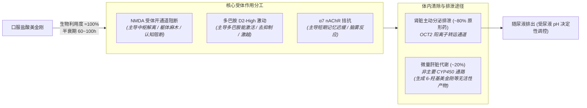

> [!danger] 当时间被无限拉长，清醒成为无法抵达的奢望。
> 美金刚具有长达 **60 ～ 100 小时** 的消除半衰期。一旦过量或在数日内连续重复给药（Redosing），原形药物将在体内剧烈蓄积，导致持续数天乃至数周的认知迟钝、情感剥离、语言受阻与不可逆的谵妄错乱——在体内完成代谢清除前，没有任何手段可以提前中止这一漫长的解离过程。

> [!danger] 危险的药物相互作用
> 氯胺酮、右美沙芬、苯环己哌啶（PCP）、金刚烷胺等 NMDA 受体拮抗剂；左旋多巴、溴隐亭等多巴胺受体激动剂；苯丙胺类、哌甲酯、可卡因等中枢神经兴奋剂；单胺氧化酶抑制剂（MAOI）；碳酸氢钠、碳酸酐酶抑制剂（乙酰唑胺）等尿液碱化剂；酒精、苯二氮䓬类、GHB/GBL、阿片类等中枢抑制剂；抗胆碱能药物

---

## 1. 核心受体机制

* **拮抗受体**：NMDA（非竞争性、低至中等亲和力、电压依赖性开通道阻滞）[\[2\]](#ref-2)
* **拮抗受体**：5-$\text{HT}_3$（血清素 3 型受体，亲和力与 NMDA 相近，具中枢抗恶心与知觉调节倾向）[\[2\]](#ref-2)
* **拮抗受体**：$\alpha_7$ nAChR（烟碱型乙酰胆碱受体，亲和力高于 NMDA，为用药早期短期记忆迟滞主因）[\[3\]](#ref-3)
* **激动受体**：多巴胺 $D_2^{\text{High}}$（纳摩尔级高亲和力功能性激动，可诱发去抑制、轻躁狂与精神病样症状）[\[9\]](#ref-9)
* **微弱作用**：$\sigma$-1 / Sigma-1（极低亲和力）[\[5\]](#ref-5)

---

## 2. 药效时间与参考剂量

### 作用时间轴

| 阶段 | 药效时长 |
| :--- | :--- |
| **总持续时间** | **18 ～ 36 小时**（主药程） |
| **药效发作** | 30 ～ 180 分钟（口服吸收极慢，通常需 2 小时以上初显感知） |
| **药效上升** | 2 ～ 4 小时 |
| **药效达峰** | 3 ～ 8 小时（常释制剂 $T_{\max}$ 约为 3 ～ 7 小时） |
| **药效平台** | 12 ～ 24 小时 |
| **药效褪去** | 12 ～ 24 小时 |
| **药效残余** | **24 ～ 72+ 小时**（认知迟缓与脑雾，完全排净需 10 ～ 20 天） |

### 参考剂量

针对无耐药性标准体重的参考剂量阶梯（以口服盐酸美金刚常释片为基准）[\[1\]](#ref-1)[\[4\]](#ref-4)[\[8\]](#ref-8)：

| 级别 | 单次总剂量区间 | 对应状态预估 |
| :--- | :--- | :--- |
| **医学剂量** | 5 ～ 20 mg | 临床常规剂量（每日 5～20mg 分次），仅用于延缓痴呆，无解离反应，思维清晰 |
| **轻微** | 20 ～ 60 mg | 轻度躯体轻盈、情绪平淡、抗抑郁、视听轻度疏离感 |
| **中等** | 60 ～ 100 mg | 精神作用显著，明确解离感知，时空感扭曲，语言逻辑与短期记忆受阻，步态蹒跚 |
| **强烈** | 100 ～ 150 mg | 深度解离（自我认知与肉体分离），空间感知严重失真，闭眼几何知觉，日常生活能力丧失 |
| **严重** | 150 mg + | 极度解离与知觉剥夺，严重共济失调、谵妄样状态与急性精神错乱风险 |

> [!danger] 超长半衰期（60～100 小时）与体内蓄积性中毒警示
> 盐酸美金刚在健康人体内的消除半衰期长达 **60 ～ 100 小时**[\[2\]](#ref-2)[\[6\]](#ref-6)（约为主流中短效物质的数十倍）。
> 
> * **致命的追加给药误区（Redosing Trap）**：因口服达峰极其迟缓（需 3～7 小时），初涉者极易在服药后 2 小时因“毫无感觉”而误判剂量不足，盲目追加用药。这种行为会导致数小时后血药浓度呈几何级叠加，直接诱发持续数天的急性严重中毒。
> * **多日蓄积效应**：药物在体内的消除需历经 4～5 个半衰期（约 12～20 天）。若以短间隔（如每日或隔日）连续服用大于临床剂量（>20mg）的药物，体内原药根本无法排出并产生指数级蓄积，稳态血药浓度可高达单次服药的 3～5 倍，引发持久性精神解离、重度抑郁样崩溃与持久认知迟钝[\[1\]](#ref-1)[\[6\]](#ref-6)。

---

## 3. 剂量反应与分级表现（无耐药性，以口服盐酸盐为准）

美金刚主观体验以“感知疏离、机械化分析感、情绪平淡”为主，完全缺乏血清素受体激动的温热感与安抚感，时间跨度显著长于其他解离剂[\[1\]](#ref-1)[\[4\]](#ref-4)[\[8\]](#ref-8)：

| 预计层级 | 最低剂量 | 最高剂量 | 核心表现 |
| :--- | :--- | :--- | :--- |
| **医学剂量** | — | 5 ～ 20 mg/日 | 仅神经保护与阻断谷氨酸过度释放的兴奋毒性；临床用于中重度阿尔茨海默病；无解离反应，认知基本正常。 |
| **第一阶梯（轻微）** | 20 mg | 60 mg | 出现轻微情绪中立与轻盈漂浮感；感官出现微弱疏离感（类似轻微酒意但意识清醒冷淡），音乐感知轻微提升。 |
| **第二阶梯（中等）** | 60 mg | 100 mg | 精神作用显著，解离出现；本体感觉迟钝，共济失调与特征性机械步态，难以专注；短期记忆与词汇调用明显受阻。 |
| **第三阶梯（强烈）** | 100 mg | 150 mg | 深度知觉阻断；自我意识与肉体显著剥离，短期记忆几乎归零；闭眼呈现冷峻几何知觉；完全丧失日常社交与自理能力。 |
| **第四阶梯（极量/过量）** | 150 mg | 200 mg+ | 意识深度剥离；运动控制完全丧失；高血压危象、心动过速、高热与急性精神运动性激越风险剧增。 |
| **蓄积中毒 / 致死过量** | 频次蓄积给药 / $\ge$ 200 mg | — | † 谵妄与中毒危象 † |

> [!danger] 频次追加给药（Redosing）与多巴胺性精神错乱警示
> * **多巴胺性谵妄发作**：美金刚具备纳摩尔级多巴胺 $D_2^{\text{High}}$ 态受体激动活性[\[9\]](#ref-9)。大剂量单次摄入或多次补药蓄积后，NMDA 阻断导致的解离与多巴胺过度刺激交织叠加，极易诱发长达 **48 ～ 96 小时** 的严重急性精神分裂样错乱、被害妄想、视听幻觉与狂躁激越状态。
> * **急性过量致死风险**：临床医学急救记录显示，单次超大剂量口服（数百毫克至数克）会导致中枢性呼吸抑制、癫痫发作、心律失常、横纹肌溶解甚至昏迷死亡[\[1\]](#ref-1)[\[6\]](#ref-6)。由于美金刚全身表观分布容积极大（9～11 L/kg）且蛋白结合率低，**临床血液透析对其几乎无效**，一旦发生过量只能依赖 ICU 生命体征支持监护。

> [!warning] 警惕尿液碱化引发的体内蓄积中毒
> 美金刚约 **80% 均以原形经由肾小管主动排泄随尿液排出**[\[2\]](#ref-2)[\[6\]](#ref-6)。其排泄速率直接取决于尿液酸碱度（pH 值）：
> 
> 若在用药期间摄入**碳酸氢钠（苏打粉、小苏打胃药）、碳酸酐酶抑制剂（乙酰唑胺）**或因剧烈饮食改变使尿液呈碱性（pH $\ge$ 8），肾小管对美金刚的非离子化重吸收将急剧增加，**导致美金刚的肾清除率断崖式暴跌高达 80%**[\[2\]](#ref-2)[\[6\]](#ref-6)！原本常规的剂量在体内会因排泄阻断而迅速累积到严重中毒浓度，引发难以挽回的中枢神经毒性反应！

---

## 4. 近代史

**盐酸美金刚**（Memantine Hydrochloride）是一种环状金刚烷（Adamantane）胺类化合物，与抗流感病毒药物金刚烷胺（Amantadine）同源。

* **研发背景（1968 年）**：最早由礼来公司（Eli Lilly）合成，原计划作为新型降血糖药物研发，后因临床未见降糖活性而搁置[\[3\]](#ref-3)。
* **机制发现与上市审批**：后续德国 Merz 药厂研究证实其具备独特的电压依赖性低至中等亲和力 NMDA 受体阻滞特性，能特异性抑制谷氨酸病理性过度兴奋引起的神经细胞毒性，同时保留生理性信号传导。美金刚于 1989 年在德国获批上市；随后分别于 **2002 年获欧洲药品管理局（EMA）批准**、**2003 年获美国食品药品监督管理局（FDA）批准**，成为首个获批用于治疗中度至重度阿尔茨海默病（AD）的非竞争性 NMDA 拮抗剂[\[2\]](#ref-2)[\[6\]](#ref-6)。
* **亚文化扩散与滥用隐患**：随着促智药（Nootropics）社区对受体耐受重塑与精神科对难治性强迫症（OCD）探索的报道增多，部分群体开始利用其过量解离特性寻求解离体验。但由于其半衰期极其冗长，非医疗滥用导致的急诊急性中毒与谵妄病例在临床屡见不鲜[\[1\]](#ref-1)[\[8\]](#ref-8)。
* **监管属性**：在中国及全球主流医药监管体系中，美金刚均严格作为**处方药（Rx）**管理，未经医生处方严禁私自获取与滥用。

---

## 5. 药理机制与体内代谢全景

### 肾清除动力学与减害调控

美金刚在体内的代谢清除途径与高度依赖肝脏 CYP2D6/CYP3A4 的右美沙芬截然不同：**美金刚几乎不依赖肝脏细胞色素 P450 酶系代谢，约 80% 均以原形经肾小管通过有机阳离子转运体（OCT2）主动分泌随尿液排出**[\[2\]](#ref-2)[\[6\]](#ref-6)。这一特征决定了其独特的减害关注要点：

#### 碱化尿液：极其危险，清除率骤降 80%
* **原理**：美金刚属于脂溶性弱碱（pKa 约为 10.27）。在酸性尿液中主要呈带正电荷的解离离子态，难以透过细胞膜，易随尿排出；但在碱性尿液（pH $\ge$ 8）中，未解离的原形分子比例增加，在肾小管中被迅速且大量重吸收回血液循环。
* **高危诱因**：同服碳酸氢钠（苏打粉、含苏打胃药）、碳酸酐酶抑制剂（如乙酰唑胺）、噻嗪类利尿剂，或短时间内剧烈改变饮食为纯碱性饮食。
* **临床后果**：**尿液碱化可导致美金刚的肾清除率断崖式暴跌约 80%**！原本极长的半衰期成倍延长，可在体内蓄积诱发致死性中毒[\[2\]](#ref-2)[\[6\]](#ref-6)。

#### 酸化尿液与水化利尿：促进排泄，减害应急
* **原理**：酸性尿液使美金刚完全维持离子化状态，阻断肾小管重吸收，极大加速其随尿排出。
* **临床减害应用**：在出现过量或蓄积危象送医后，临床在维持水电解质平衡与心电监护的前提下，常采用**充分补液水化利尿**与**酸性利尿支持（如在严密监控下使用酸化尿液药物）**，以缩短药物在体内的暴露时间[\[6\]](#ref-6)。

> [!danger] 严禁与右美沙芬、氯胺酮或其他 NMDA 拮抗剂联用
> 美金刚与右美沙芬或氯胺酮同用会造成中枢 NMDA 受体的叠加深度阻滞，导致极其严重且难以逆转的运动失调、知觉丧失、呼吸中枢抑制与中毒性脑病，具有极高致死风险！

---

## 参考来源

1. [美金刚 - FreeODwiki——可自由编辑的开源Overdose百科](https://freeodwiki.org/%E8%8D%AF%E7%89%A9/%E7%BE%8E%E9%87%91%E5%88%9A.html)
2. [Memantine: Uses, Interactions, Mechanism of Action - DrugBank (DB01043)](https://go.drugbank.com/drugs/DB01043)
3. [Memantine - Wikipedia (The Free Encyclopedia)](https://en.wikipedia.org/wiki/Memantine)
4. [Memantine Vault - Erowid](https://www.erowid.org/pharms/memantine/)
5. [Memantine (3,5-dimethyladamantan-1-amine hydrochloride) - Isomer Design (PiHKAL Explore #12180)](https://isomerdesign.com/PiHKAL/explore.php?id=12180)
6. [Memantine Hydrochloride Consumer Information & Monograph - Drugs.com](https://www.drugs.com/cdi/memantine.html)
7. [Memantine Wiki & Pharmacology - Drugs-Forum](https://drugs-forum.com/wiki/Memantine)
8. [Community Experiences, Dosing Guidelines and Harm Reduction - r/MemantineHCl (Reddit)](https://www.reddit.com/r/MemantineHCl/)
9. [Seeman P, Caruso C, Lasaga M. Memantine agonist action at dopamine D2High receptors. Synapse, 2008, 62(2): 149-153 (PubMed: 18000814)](https://pubmed.ncbi.nlm.nih.gov/18000814/) —— 证实美金刚以高亲和力激动多巴胺 $D_2^{\text{High}}$ 态受体，揭示其诱发多巴胺能反应、激越及精神病样症状的受体药理学基础。
